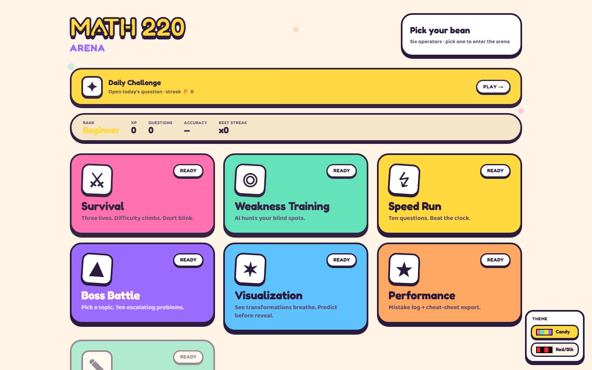
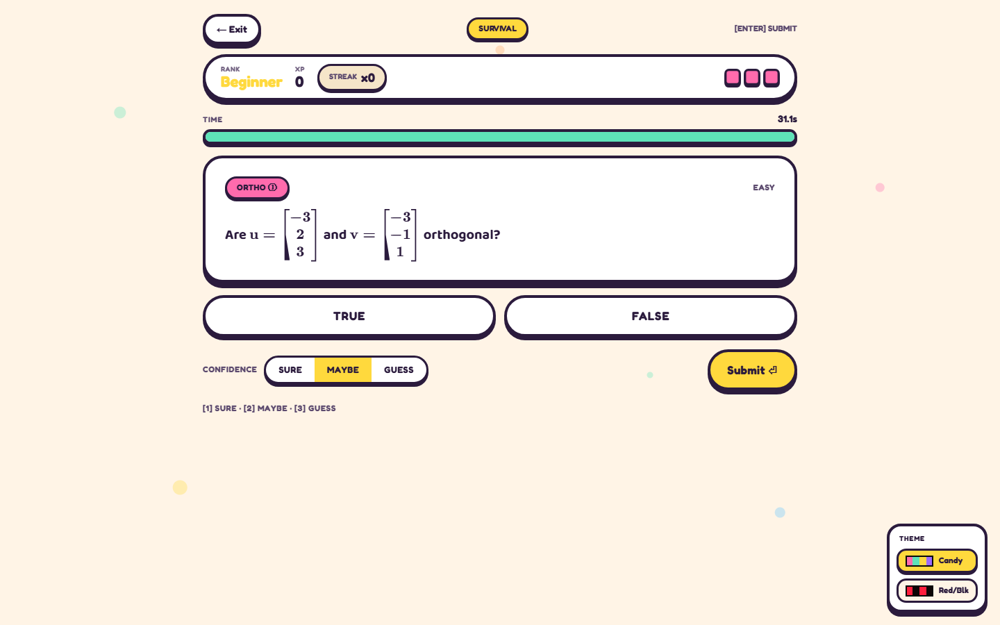
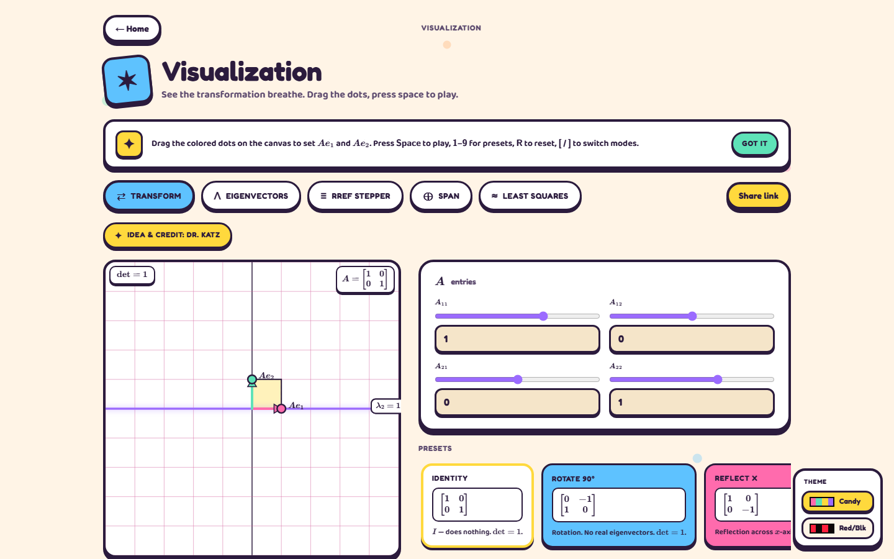

# Math 220 Arena


An open-source, adaptive **linear algebra training game**. It procedurally
generates unlimited practice problems, tracks which topics you're weak on,
and keeps bringing your mistakes back until you've learned them.

Built to help students prepare for the MATH 220 (linear algebra) final.

**[▶ Play it live: math220-arena.vercel.app](https://math220-arena.vercel.app)** (no sign-up, works in the browser)



## Features

**Seven game modes**

| Mode | What it does |
|---|---|
| **Survival** | Three lives, difficulty ramps up, timed questions |
| **Weakness Training** | Adaptive engine targets the topics where your accuracy is lowest |
| **Speed Run** | Ten questions, scored on speed and accuracy |
| **Boss Battle** | Pick one topic and face ten escalating problems |
| **Daily Challenge** | One shared question a day, with a streak counter |
| **Visualization** | Interactive canvas for transformations, eigenvectors, RREF, span and least squares |
| **Review** | Topic summaries plus a personal mistake log and exportable cheat sheet |

**Seven topics:** RREF & systems · linear independence & span · basis &
dimension · eigenvalues & eigenvectors · orthogonality & projections ·
least squares · matrix operations, determinants & inverses



## How the learning engine works

- **Procedural problem generation.** Each topic has its own generator
  (`lib/generators/`) that builds problems with exact, verifiable answers
  at three difficulty levels, so no two runs are the same.
- **Spaced repetition.** Missed questions come back after 3, then 7, then
  21 questions, using an SM-2-style interval and ease schedule (`lib/srs.ts`).
- **Adaptive difficulty.** Per-topic mastery is tracked as an exponential
  moving average and drives topic and difficulty selection (`lib/adaptive.ts`).
- **Interleaving.** You never get two questions in a row from the same topic
  (except in Boss Battle), because mixing topics improves retention.
- **Confidence calibration.** You mark each answer *Sure*, *Maybe* or *Guess*.
  Confident wrong answers cost more XP than guesses, which trains you to
  know what you actually know.
- **Answer-aware grading.** The grader accepts mathematically equivalent
  answers, such as eigenvectors in any order or any scalar multiple
  (`lib/grade.ts`).

## Interactive visualizer

Drag the basis vectors to see a 2×2 matrix transform the plane in real time,
with the determinant shown as the area of the transformed unit square. Other
modes animate eigenvectors, step through row reduction (including finding
an inverse and checking A·A⁻¹ = I), and show span and least-squares fits.
Equations are rendered with KaTeX. *(The transformation idea is credited to
Dr. Katz.)*



## Architecture

```text
app/
├── page.tsx              Home: modes, daily challenge, stats
├── play/[mode]/          Shared game loop for all play modes
├── viz/                  Visualization sandbox
├── review/[topic]/       Topic review pages
├── stats/                Mastery dashboard, mistake log, cheat sheet export
└── api/                  question · evaluate · profile · history · daily
lib/
├── generators/           One procedural problem factory per topic
├── matrixMath.ts         RREF, eigen, det, inverse (mathjs)
├── adaptive.ts           Topic + difficulty selection
├── srs.ts                Spaced-repetition scheduling
├── grade.ts              Equivalence-aware answer checking
└── scoring.ts            XP with confidence, speed and streak multipliers
components/               Question card, answer input, HUD, timer, visualizers
```

**Production setup at $0/month**

- Each visitor gets an anonymous profile stored in an httpOnly cookie, so no login is needed.
- Progress is stored in **Upstash Redis** (serverless) and validated with **Zod**.
- Write endpoints are rate-limited per user (30 requests per 10 seconds) to stay inside free-tier limits.
- **Graceful degradation:** if Redis is down, progress falls back to signed browser cookies, so the game keeps working and syncs back when Redis recovers.

## Run locally

```bash
git clone https://github.com/gdayoub/Math220Game.git
cd Math220Game
npm install
npm run dev
```

Open http://localhost:3000. In development, progress is saved to local JSON
files in `data/`, so no database is needed.

**Tests**

```bash
npx tsx scripts/smoke-generators.ts          # 630 generated problems must self-grade correctly
node scripts/smoke-game.mjs http://localhost:3000   # end-to-end, including a simulated Redis outage
```

## Deploy your own

1. Fork the repo and import it on [Vercel](https://vercel.com/new).
2. Add the **Upstash for Redis** integration from Vercel → Storage. It injects `KV_REST_API_URL` and `KV_REST_API_TOKEN`.
3. Optionally set `PROFILE_COOKIE_SECRET`, used to sign the fallback cookies when Redis is not configured.

## Contributing

Issues and pull requests are welcome. Good first contributions:

- New problem generators or topics (see `lib/generators/` for the pattern)
- More visualizer modes
- Accessibility improvements

## Author

**George Dayoub**: [GitHub](https://github.com/gdayoub) · [Portfolio](https://george-dayoub-portfolio.vercel.app)

## License

[MIT](LICENSE)
